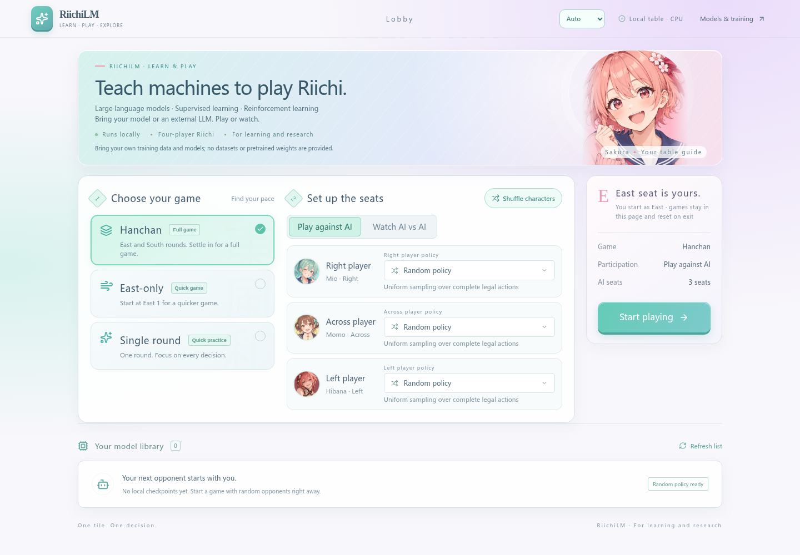
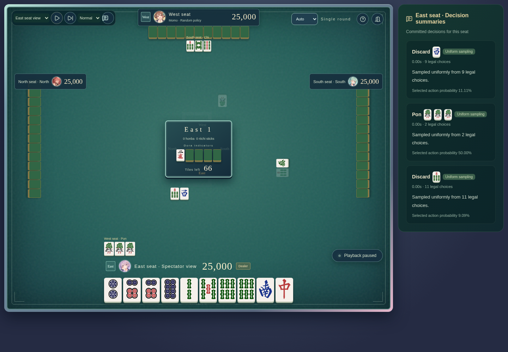

[English](README.md) · [简体中文](docs/i18n/zh-CN/README.md) · [日本語](docs/i18n/ja/README.md)

# RiichiLM

**Teaching Machines to Play Riichi Mahjong with LLMs and RL**

Build a Mahjong policy, train it on your own data, improve it through self-play, and watch its decisions at a real table. RiichiLM connects Qwen3-based sequence models, a Rust rules engine, reinforcement learning, and an illustrated browser arena in one research codebase.

> **For learning and research only. We do not provide training data, evaluation datasets, pretrained models, or trained checkpoints.** Bring your own appropriately licensed, compatible data and train your own models. You may continue training from a compatible checkpoint you provide. Random opponents work without any weights; external LLM players use a service you configure.

## Why RiichiLM?

| Feature | What you can explore |
| --- | --- |
| **Mahjong as a sequence** | A Mahjong tokenizer and Qwen3-based autoregressive policy; 8,192-token context with the current round and up to three previous rounds from the same game. Models initialize with random weights, without downloading a pretrained Qwen model. |
| **Legal actions by construction** | Rust-backed rules and a legal-action trie constrain complete actions, including call combinations and discard details. The actor sees only its own projected information. |
| **Train, then self-play** | Action-token supervision, KL-anchored PPO, a training-only Oracle Critic, and a bounded frozen-opponent pool. Privileged Critic inputs are separate from actor observations. |
| **Reuse shared context** | Up to eight decisions share a training trunk within the same round and view. Eligible GPU BF16 runs use compiled layers, fused Adam, merged projections, and CPU lookahead. |
| **Resume the actual run** | Checkpoints retain model, optimizer, RNG, progress, and data cursor. RL supports READY/PREPARED round boundaries and recomputation of interrupted work. |
| **See the policy play** | React/TypeScript arena for human vs AI and four-AI spectating. Mix your local NTP checkpoints, external LLMs, and random players independently by seat. |
| **An arena in three languages** | English, Simplified Chinese, and Japanese; browser-language selection, a persistent manual switch, pause, step, speed, and viewing-seat controls. |

## A look at the arena



Choose a single round, East-only game, or hanchan. Illustrated characters are cosmetic; policies are selected independently. No account is needed for the local arena.



Watch committed moves, legal-choice counts, sampling probabilities, and short summaries when supplied by an LLM. Summaries are model output, not an internal reasoning trace. A human player does not receive opponents' summaries. These screenshots use random opponents; they do not demonstrate trained playing strength.

## Train with your own inputs

Set up the Python environment and rules engine in [Install and play](#install-and-play) before running these commands. The frontend is only needed for the browser arena.

The training interfaces consume compatible **processed** policy corpora, not arbitrary raw logs. Supply the corpus manifest, indexes, compressed records, action supervision, and matching tokenizer/rule bindings; the generic reader supports `mahjong-policy-corpus/1` and compatible text/3 builds. Source-specific downloads, raw-log parsers, and private processing pipelines are outside the public scope.

The public configuration disables the optional Nanikiru benchmark. To evaluate on your own compatible question set, pass `evaluation.nanikiru_dir=/absolute/path/to/your/evaluation`. Pass `evaluation.nanikiru_dir=null` to use only the held-out corpus. No evaluation dataset is bundled. Full resume retains the saved choice; checkpoints created before this option retain their original evaluation input requirement.

Once you have supplied all required inputs:

```bash
.venv/bin/python -m mahjong pretrain \
  data.build_dir=/absolute/path/to/your/compatible-corpus \
  training.max_updates=200 data.validation_max_samples=32

.venv/bin/python -m mahjong resume \
  --run outputs/YOUR_RUN_ID --checkpoint latest training.max_updates=10000

.venv/bin/python -m mahjong rl train \
  --init-checkpoint /absolute/path/to/your/compatible-ntp-checkpoint \
  --device cpu --output outputs/rl
```

`training.max_updates` is an **absolute total**, including on resume. New pretraining defaults to GPU BF16; `runtime.device=cpu runtime.precision=32-true` selects CPU FP32 for a suitable small configuration. Full resume preserves the saved precision/device and requires compatible model, data, configuration, and state formats. Changing the runtime environment may change numerical results.

RL initialization currently requires your compatible NTP checkpoint **and its corresponding processed training corpus** for identity verification. An arbitrary standalone Actor file is not an interchangeable initialization input. The Web model picker currently supports NTP checkpoints, not RL Actor snapshots.

## Install and play

Use Linux/WSL, Python 3.14, and **one** dependency variant. The existing ROCm baseline targets AMD RX 7900 XTX / gfx1100. For NVIDIA, replace `requirements-rocm.txt` below with `requirements-cuda.txt` (CUDA 13.0). CUDA execution still needs independent validation; a dependency file is not a GPU test.

```bash
uv venv --python 3.14.7 .venv
uv pip install --python .venv/bin/python -r requirements-rocm.txt
uv pip install --python .venv/bin/python --no-deps -e .
uv pip check --python .venv/bin/python
```

Build the bundled rules engine with Rust 1.92.0 and maturin. The build below omits source-specific replay adapters:

```bash
.venv/bin/python -m maturin build --release --locked --no-default-features \
  --manifest-path envs/riichienv/riichienv-python/Cargo.toml \
  --interpreter .venv/bin/python --out outputs/wheels
uv pip install --python .venv/bin/python --no-deps outputs/wheels/riichienv-*.whl
```

Build the frontend with Node.js 20.19+ or 22.12+, then start the local server:

```bash
(cd web && npm ci && npm run build)
.venv/bin/python -m mahjong web-play --device cpu
```

Open the printed loopback URL. Start with random opponents; no data, model download, or API key is needed. Once built, production serving needs only Python. The server is intended for local use. Games live in the current session; refreshing or exiting starts over.

To add external LLM players, create a local JSON configuration using this structure, then add `--llm-config /path/to/players.json` to `web-play`:

```json
[
  {
    "id": "local",
    "name": "My local LLM",
    "model": "your-served-model",
    "base_url": "http://127.0.0.1:8000/v1",
    "max_tokens": 512,
    "max_attempts": 2,
    "request_timeout": 60
  }
]
```

For an authenticated endpoint, add `"api_key_env": "YOUR_LLM_API_KEY"` and set that variable in the **server's** environment. Keys stay on the server. Each external LLM receives its own visible state and legal choices; its service handles generation and sampling. Service access, costs, latency, and compatibility depend on your provider. Free-text model summaries retain the language returned by that model.

## Research status and scope

The code includes supervised training, inference, self-play collection, PPO updates, checkpoint recovery, and the browser arena. Bounded CPU and AMD BF16 checks exist; these do not establish competitive strength, long-term training quality, or equivalent behavior on every GPU. Public-export installation and regression are tracked separately in the [roadmap](ROADMAP.md).

This project is intended for studying decision-making and learning systems. Do not use it for cheating, live-game assistance, or unauthorized interaction with online services. This research-use statement describes project intent; the code license remains Apache-2.0.

## Contribute and license

See [CONTRIBUTING](CONTRIBUTING.md) and the [roadmap](ROADMAP.md), also available in Chinese and Japanese. Please submit minimal synthetic examples rather than private game records or weights.

Code: [Apache-2.0](LICENSE). See [NOTICE](NOTICE) for attribution. The bundled rules engine derives from [smly/RiichiEnv](https://github.com/smly/RiichiEnv); its [license](envs/riichienv/LICENSE) is retained. Qwen3 model code comes through Hugging Face Transformers. Tile art is by [FluffyStuff](https://github.com/FluffyStuff/riichi-mahjong-tiles), with its [CC0 dedication](web/src/assets/tiles/LICENSE.md) and [source notes](web/src/assets/tiles/SOURCE.md) retained. The README logo was AI-generated using the existing Web mascot as a reference. Data and model rights are separate from the code license.
