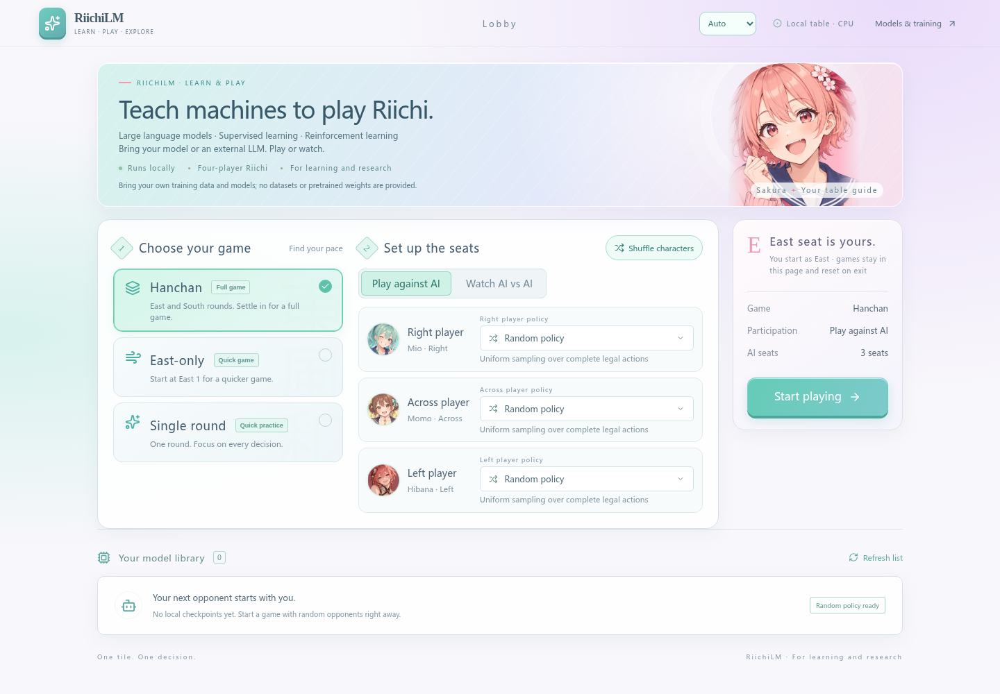
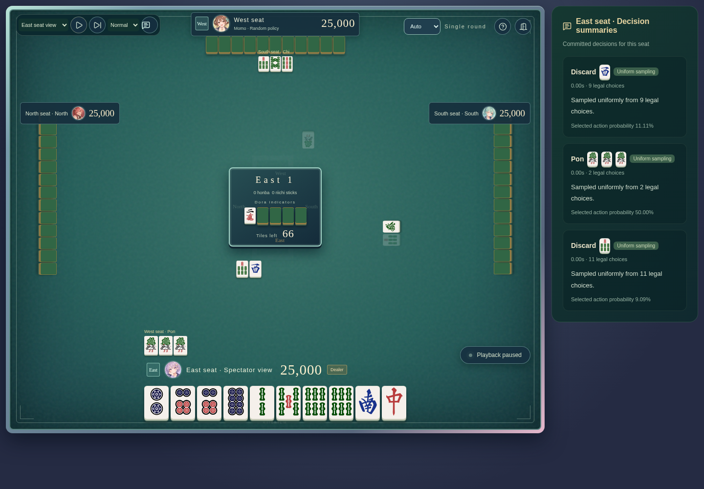

[English](../../../README.md) · [简体中文](../zh-CN/README.md) · [日本語](README.md)

# RiichiLM

[公式サイト · www.riichilm.top](https://www.riichilm.top)

**大規模言語モデルと強化学習で、機械にリーチ麻雀を教える**

自分のデータで麻雀の方策を学習し、自己対戦で改良し、実際のルールで動く卓で判断を観察する。RiichiLM は、Qwen3 ベースの系列モデル、Rust ルールエンジン、強化学習、イラスト付きブラウザー対局を一つの研究コードベースにつなぎます。

> **本プロジェクトは学習・研究用です。学習データ、評価データセット、事前学習済みモデル、学習済み checkpoint は提供しません。** 適切な利用権を持つ互換データを用意してモデルを学習できます。自分で用意した互換 checkpoint からの継続学習も可能です。ランダム対戦相手に重みは不要で、外部 LLM は利用者が設定したサービスを使います。

## 特徴

| 機能 | 研究できること |
| --- | --- |
| **麻雀を系列としてモデル化** | 麻雀専用 Tokenizer と Qwen3 ベースの自己回帰方策。8,192 token の文脈に現在の局と同じ対局の過去最大三局を含みます。モデルはランダム重みから構築し、事前学習済み Qwen の重みは取得しません。 |
| **完全な合法行動の制約** | Rust のルールと合法行動 trie で鳴きの組合せや打牌の詳細まで制約。Actor には自身から見える情報だけを渡します。 |
| **教師あり学習から自己対戦へ** | 行動 token の教師あり学習、KL 制御付き PPO、学習専用 Oracle Critic、容量を制限した凍結対戦相手プール。Critic の特権情報は Actor の観測と分離します。 |
| **長い文脈の共有** | 同じ局・視点の最大八つの判断で学習の幹を共有。条件を満たす GPU BF16 実行では、層全体のコンパイル、fused Adam、投影の統合、CPU 先読みを使います。 |
| **GPU 1枚で学習** | 既定の約1.0148億パラメータのモデルは単一GPUで学習できます。BF16学習の実測ピークは割り当て4.12 GiB／予約6.45 GiB。参考環境とスループットは下記をご覧ください。 |
| **学習状態を保って再開** | checkpoint にモデル、optimizer、RNG、進捗、データ位置を保存。RL は READY/PREPARED のラウンド境界から復帰し、中断した処理を再計算できます。 |
| **動く方策を観察** | React/TypeScript の対局・四 AI 観戦画面。各席で自前 NTP checkpoint、外部 LLM、ランダム戦略を組み合わせられます。 |
| **英・中・日の三言語** | ブラウザーの言語を自動選択し、手動設定も保存。観戦では一時停止、一手ずつ進む、速度変更、視点切替に対応。 |

## 画面紹介



一局練習・東風戦・半荘戦を選択できます。イラストのキャラクターと各席の戦略は独立しており、ローカル画面にアカウントは不要です。



確定済みの行動、合法候補数、サンプリング確率、LLM が返した短い要約を表示します。要約はモデルの出力であり、内部の思考過程ではありません。人間との対局では相手の要約を表示しません。スクリーンショットはランダム戦略によるもので、学習済みモデルの強さを示しません。

## 自分のデータで学習する

次のコマンドを実行する前に、[インストールと体験](#インストールと体験)に従って Python 環境とルールエンジンを設定してください。フロントエンドのビルドはブラウザー対局を使う場合に必要です。

学習入口が読むのは互換形式に**処理済みの方策コーパス**であり、任意の生牌譜ではありません。manifest、索引、圧縮レコード、行動の教師情報、対応する Tokenizer・ルールの識別情報が必要です。汎用 reader は `mahjong-policy-corpus/1` と互換 text/3 build に対応します。ソース固有のダウンロード・生牌譜解析・非公開処理パイプラインは公開範囲に含めません。

公開設定では任意の何切る評価を既定で無効にします。自前の互換問題セットを使う場合は `evaluation.nanikiru_dir=/absolute/path/to/your/evaluation`、検証用コーパスのみの場合は `evaluation.nanikiru_dir=null` を指定します。評価データセットは配布しません。完全な再開では保存時の設定を引き継ぎ、この項目の導入前の checkpoint は元の評価入力条件を保ちます。

必要な入力をすべて用意した後の例：

```bash
.venv/bin/python -m mahjong pretrain \
  data.build_dir=/absolute/path/to/your/compatible-corpus \
  training.max_updates=200 data.validation_max_samples=32

.venv/bin/python -m mahjong resume \
  --run outputs/YOUR_RUN_ID --checkpoint latest training.max_updates=10000

.venv/bin/python -m mahjong rl train \
  --init-checkpoint /absolute/path/to/your/compatible-ntp-checkpoint \
  --device cpu --output outputs/rl
```

`training.max_updates` は再開時も**絶対的な総更新数**です。新規事前学習の既定値は GPU BF16 です。適切な小規模設定では `runtime.device=cpu runtime.precision=32-true` で CPU FP32 を選べます。完全な再開では保存時の精度・デバイス条件を引き継ぎ、モデル・データ・設定・状態形式の互換性が必要です。実行環境の変更で数値結果が変わる場合があります。

現在の RL 初期化には互換 NTP checkpoint と、その識別情報の検証に使う元の処理済み学習コーパスが必要です。任意の単独 Actor ファイルで代用できるわけではありません。Web のモデル選択は現在 NTP checkpoint に対応し、RL Actor スナップショットには未対応です。

### 参考ハードウェアと計算スループット

現在の開発機の環境です。2026-10-31に確認しました。

| 項目 | 参考環境 |
| --- | --- |
| GPU | AMD Radeon RX 7900 XTX 1枚、VRAM 24 GB、`gfx1100` |
| CPU／メモリ | Intel Core i9-9900KF、論理CPU 16個；WSLから利用可能なRAM 23.4 GiB |
| OS | WSL2上のUbuntu 22.04.5 LTS |
| Python／GPUランタイム | Python 3.14.7；PyTorch `2.14.0+rocm10.1.0`；HIP `7.16.26385` |
| モデルライブラリ | Transformers 5.19.0；Lightning Fabric 2.6.6 |
| 学習設定 | 既定の16層・101,477,120パラメータのQwen3方策；上限8,192 token；共有グループは最大8判断；BF16計算、パラメータ・勾配・Adam状態はFP32 |

2026-10-30の限定的な学習スループット測定では、このGPU／ランタイムと既定モデルで、層全体のコンパイル、fused Adam、投影の統合、CPU先読みを使用しました。計時した2回の実行は合計378更新・2,510判断・9,370教師信号の行動tokenです。

| 計算指標 | 実測値 |
| --- | ---: |
| 平均更新時間 | 101.19 ms |
| 更新スループット | 9.88 更新／秒 |
| 判断スループット | 65.62 判断／秒 |
| 教師信号の行動tokenスループット | 244.96 token／秒 |
| GPUメモリの割り当て／予約ピーク | 4.12／6.45 GiB |

計時にはデータ準備・転送、順伝播・逆伝播、勾配検査、Adam、同期、更新ごとの状態出力を含み、起動・ウォームアップ・評価・checkpoint保存を除きます。token数は教師信号の行動tokenのみで、計算する全文脈token数ではありません。この値は測定区間の計算スループットです。メモリ使用量は入力長・グループ分け・検証・バックエンドで変わり、実測使用量は動作確認済みの最小GPU容量を示しません。

## インストールと体験

Linux/WSL、Python 3.14 と、**いずれか一つ**の依存関係構成を使います。既存の ROCm 基準環境は AMD RX 7900 XTX / gfx1100 向けです。NVIDIA では、以下の `requirements-rocm.txt` を `requirements-cuda.txt`（CUDA 13.0）に置き換えてください。CUDA 実行は別途検証が必要で、依存一覧の存在は GPU 検証済みを意味しません。

```bash
uv venv --python 3.14.7 .venv
uv pip install --python .venv/bin/python -r requirements-rocm.txt
uv pip install --python .venv/bin/python --no-deps -e .
uv pip check --python .venv/bin/python
```

Rust 1.92.0 と maturin で同梱のルールエンジンをビルドします。以下の構成にはデータソース固有のリプレイ解析器を含めません。

```bash
.venv/bin/python -m maturin build --release --locked --no-default-features \
  --manifest-path envs/riichienv/riichienv-python/Cargo.toml \
  --interpreter .venv/bin/python --out outputs/wheels
uv pip install --python .venv/bin/python --no-deps outputs/wheels/riichienv-*.whl
```

Node.js 20.19+ または 22.12+ でフロントエンドをビルドし、ローカルサーバーを起動します。

```bash
(cd web && npm ci && npm run build)
.venv/bin/python -m mahjong web-play --device cpu
```

表示されたループバック URL を開きます。ランダム戦略ならデータ・モデルのダウンロード・API キーは不要です。ビルド後の配信には Python のみ必要です。サーバーはローカル利用向けで、対局は現在のセッション内だけに保持され、再読み込み・退出後は最初からになります。

GPU でモデルを使う場合は `--device cuda:0` を指定します（ROCm も同じ名称です）。Web 推論は BF16 計算と FlashAttention を使い、モデルパラメータは FP32 を保持します。CPU 推論は FP32 です。GPU モデル推論には BF16 と FlashAttention の対応が必要で、利用できない場合は明示的にエラーになります。半精度計算では FP32 と確率やサンプリング結果が異なる場合があります。

自前の Qwen3 方策重みは `.pt`／`.pth` を `weights/` に置いてモデル一覧を更新するか、`--weights-root /path/to/weights` で指定します。学習用 `state.pt`、推論用エクスポート、裸の `state_dict` に対応し、run メタデータ・学習データ・指紋の一致を要求しません。テンソルとネットワーク構造の互換性は必要です。裸の重みは現在の v2 入力、8192 token、RoPE theta 1000000 を既定とし、同名の `.json` モデル設定で変更できます。`.venv/bin/python -m mahjong export-weights --checkpoint /path/to/state.pt --output weights/my-policy.pt` で optimizer と復帰状態を除去し、テンソル精度と元ファイルを保持します。

外部 LLM を追加するには、次の構造の JSON 設定を作成し、`web-play` に `--llm-config /path/to/players.json` を追加します。

```json
[
  {
    "id": "local",
    "name": "ローカル LLM",
    "model": "your-served-model",
    "base_url": "http://127.0.0.1:8000/v1",
    "max_tokens": 512,
    "max_attempts": 2,
    "request_timeout": 60
  }
]
```

認証が必要なら `"api_key_env": "YOUR_LLM_API_KEY"` を追加し、**サーバー側**の環境変数を設定します。キーはサーバーに保持します。各 LLM に渡すのはその席の可視状態と合法候補だけで、生成とサンプリングは接続先が行います。利用条件・費用・遅延・互換性は提供元に依存します。自由記述の判断要約はモデルが返した言語を保ちます。

## 研究段階と利用範囲

コードには教師あり学習、推論、自己対戦収集、PPO 更新、checkpoint 復帰、ブラウザー対局を含みます。範囲を限定した CPU・AMD BF16 検証はありますが、競技的な強さ、長期学習の品質、すべての GPU での同等動作を保証するものではありません。公開用エクスポートの独立インストール・回帰検証は[ロードマップ](ROADMAP.md)で追跡します。

意思決定と機械学習システムの学習・研究を目的としています。不正行為、対局中のリアルタイム支援、オンラインサービスへの無断接続には使用しないでください。これはプロジェクトの利用意図の表明であり、コードのライセンスは Apache-2.0 のままです。

## 貢献とライセンス

[貢献ガイド](CONTRIBUTING.md)と[ロードマップ](ROADMAP.md)をご覧ください。英語・中国語・日本語を用意しています。不具合報告には非公開牌譜や重みではなく、最小の合成例を使用してください。

コードは [Apache-2.0](../../../LICENSE)、帰属は [NOTICE](../../../NOTICE) を参照。ルールエンジンは [smly/RiichiEnv](https://github.com/smly/RiichiEnv) を基にし、[ライセンス](../../../envs/riichienv/LICENSE)を保持しています。Qwen3 実装は Hugging Face Transformers 経由です。牌画像は [FluffyStuff](https://github.com/FluffyStuff/riichi-mahjong-tiles) によるもので、[CC0 表明](../../../web/src/assets/tiles/LICENSE.md)と[出典](../../../web/src/assets/tiles/SOURCE.md)を保持しています。README のロゴは既存の Web キャラクターを参照して AI で生成しました。データ・モデルの権利はコードのライセンスとは別です。
