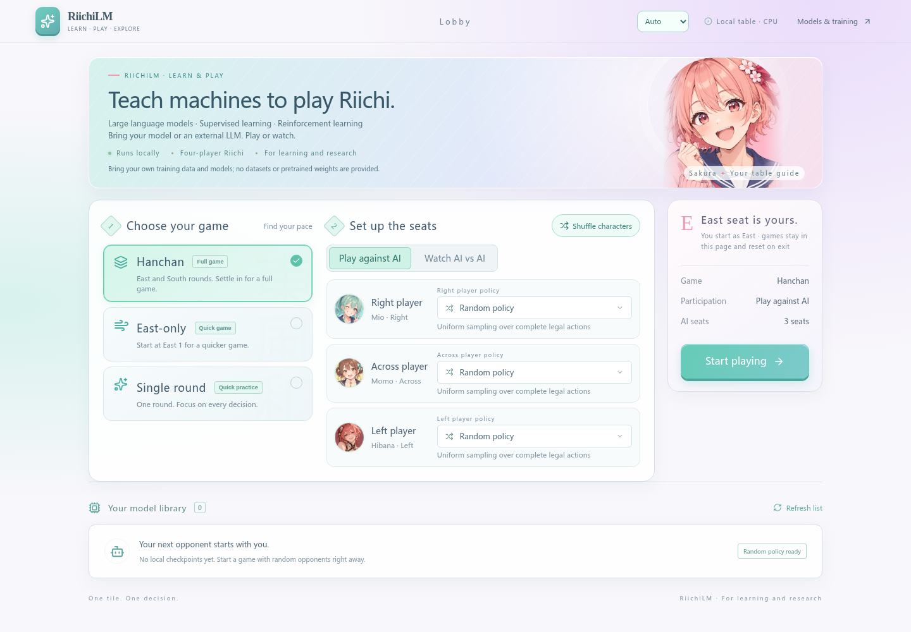
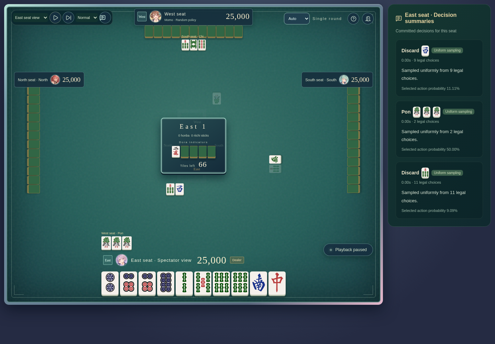

[English](../../../README.md) · [简体中文](README.md) · [日本語](../ja/README.md)

# RiichiLM

**通过大语言模型与强化学习，让机器学打立直麻将**

用自己的数据训练麻将策略，通过自我对弈改进模型，再到真实规则的牌桌上观察它的选择。RiichiLM 将 Qwen3 序列模型、Rust 规则引擎、强化学习与插画风浏览器牌桌连接在同一套研究代码中。

> **项目仅供学习与研究，不提供任何训练数据、评测数据集、预训练模型或训练后的 checkpoint。** 使用者可自行提供拥有相应使用权且格式兼容的数据训练模型，也可提供兼容 checkpoint 继续训练。随机对手无需权重；外接 LLM 使用你自行配置的服务。

## 项目亮点

| 能力 | 可以研究什么 |
| --- | --- |
| **把麻将建模为序列** | 专用 Tokenizer 与 Qwen3 自回归策略；8,192 token 上下文包含当前局及同场最多三个已结束局。模型从随机权重构造，不下载预训练 Qwen 权重。 |
| **完整合法动作约束** | Rust 规则与合法动作 trie 共同约束吃碰组合、舍牌细节等完整动作；Actor 只接收自己的可见投影。 |
| **监督学习到自我对弈** | 动作 token 监督、KL 约束 PPO、仅训练使用的 Oracle Critic，以及有界冻结对手池。Critic 的特权信息与 Actor 观测分离。 |
| **共享长上下文** | 同局同视角最多八个决策共享训练主干；合资格 GPU BF16 路径接入整层编译、fused Adam、合并投影和 CPU 前瞻准备。 |
| **保留完整训练状态** | checkpoint 保存模型、优化器、RNG、进度及数据游标；RL 支持 READY/PREPARED 轮边界恢复及中断工作的重算。 |
| **看得见的 AI 对局** | React/TypeScript 界面，支持真人对战与四 AI 观战；每席独立混搭自备 NTP checkpoint、外接 LLM 与随机策略。 |
| **中英日三语牌桌** | 根据浏览器选择语言，支持手动切换并记忆偏好；观战提供暂停、单步、速度和视角切换。 |

## 界面预览



单局、东风、半庄三种赛制自由选择。插画角色仅影响外观，各席策略独立选择；本地界面无需账号。



查看已提交动作、合法候选数量、采样概率，以及 LLM 返回的简短说明。说明是模型输出，不是内部思维链；真人对战不会展示对手说明。截图使用随机策略，不代表训练后棋力。

## 使用自备数据训练

执行下列命令前，先按[安装与体验](#安装与体验)配置 Python 环境和规则引擎。只有使用浏览器牌桌时才需要构建前端。

训练入口读取格式兼容的**已处理策略语料**，不直接接收任意原始牌谱。需要提供语料 manifest、索引、压缩正文、动作监督，以及匹配的 Tokenizer／规则绑定；通用 reader 支持 `mahjong-policy-corpus/1` 和兼容 text/3 build。具体来源的下载、原始牌谱解析和私有处理流水线不在开源范围。

公开配置默认不启用可选的何切评测。若有自备兼容题集，可设置 `evaluation.nanikiru_dir=/absolute/path/to/your/evaluation`；`evaluation.nanikiru_dir=null` 仅验证留出语料。项目不分发评测数据集。完整续训沿用保存的选择；新增该选项前的旧 checkpoint 保持原评测输入要求。

提供完整输入后，可使用：

```bash
.venv/bin/python -m mahjong pretrain \
  data.build_dir=/absolute/path/to/your/compatible-corpus \
  training.max_updates=200 data.validation_max_samples=32

.venv/bin/python -m mahjong resume \
  --run outputs/YOUR_RUN_ID --checkpoint latest training.max_updates=10000

.venv/bin/python -m mahjong rl train \
  --init-checkpoint /absolute/path/to/your/compatible-ntp-checkpoint \
  --device cpu --output outputs/rl
```

`training.max_updates` 始终表示**绝对总目标**，续训也一样。新建预训练默认 GPU BF16；小配置可使用 `runtime.device=cpu runtime.precision=32-true` 选择 CPU FP32。完整恢复保留原精度／设备约定，要求模型、数据、配置和状态格式兼容；更换环境后数值轨迹可能变化。

当前 RL 初始化需要兼容的 NTP checkpoint，及其对应的已处理训练语料用于身份核验，不能任意用独立 Actor 文件替代。Web 模型选择器目前支持 NTP checkpoint，暂不加载 RL Actor 快照。

## 安装与体验

使用 Linux/WSL、Python 3.14，并选择**一种**依赖环境。既有 ROCm 基线面向 AMD RX 7900 XTX / gfx1100；NVIDIA 用户将下方的 `requirements-rocm.txt` 替换为 `requirements-cuda.txt`（CUDA 13.0）。CUDA 仍需独立运行验证，依赖清单不代表 GPU 已验收。

```bash
uv venv --python 3.14.7 .venv
uv pip install --python .venv/bin/python -r requirements-rocm.txt
uv pip install --python .venv/bin/python --no-deps -e .
uv pip check --python .venv/bin/python
```

使用 Rust 1.92.0 与 maturin 编译仓库附带的规则引擎；以下构建不包含具体来源的回放解析器：

```bash
.venv/bin/python -m maturin build --release --locked --no-default-features \
  --manifest-path envs/riichienv/riichienv-python/Cargo.toml \
  --interpreter .venv/bin/python --out outputs/wheels
uv pip install --python .venv/bin/python --no-deps outputs/wheels/riichienv-*.whl
```

使用 Node.js 20.19+ 或 22.12+ 构建前端，再启动本地服务：

```bash
(cd web && npm ci && npm run build)
.venv/bin/python -m mahjong web-play --device cpu
```

打开终端打印的本机地址，选择随机对手即可开始，无需数据、模型下载或 API 密钥。构建完成后，生产服务只需 Python。服务用于本机访问；对局只保留在当前会话中，刷新或退出后重新开始。

外接 LLM：自行创建以下结构的 JSON 配置，在 `web-play` 后追加 `--llm-config /path/to/players.json`：

```json
[
  {
    "id": "local",
    "name": "我的本地 LLM",
    "model": "your-served-model",
    "base_url": "http://127.0.0.1:8000/v1",
    "max_tokens": 512,
    "max_attempts": 2,
    "request_timeout": 60
  }
]
```

需要认证时，增加 `"api_key_env": "YOUR_LLM_API_KEY"`，并在**服务端**设置对应环境变量。密钥留在服务端。外接 LLM 只接收本席可见状态及合法候选，生成和采样由其服务完成。服务访问、费用、延迟与兼容性取决于你的提供方。模型自由文本说明保留其返回的语言。

## 研究状态与使用范围

现有代码包含监督训练、推理、自我对弈采集、PPO 更新、checkpoint 恢复与浏览器牌桌。已有有界 CPU 和 AMD BF16 验证，但不代表竞技棋力、长期训练质量或全部 GPU 上的等价行为。公开导出版本的独立安装与回归在[路线图](ROADMAP.md)中单独跟踪。

项目用于学习决策与机器学习系统。请勿用于作弊、实时对局辅助或未经授权接入在线服务。研究用途声明表达项目意图，代码许可保持 Apache-2.0。

## 贡献与许可

请阅读[贡献指南](CONTRIBUTING.md)及[路线图](ROADMAP.md)，均提供中英日版本。复现问题请使用最小合成样例，不提交私有牌谱或权重。

代码采用 [Apache-2.0](../../../LICENSE)，归属见 [NOTICE](../../../NOTICE)。规则引擎基于 [smly/RiichiEnv](https://github.com/smly/RiichiEnv)，保留其[许可](../../../envs/riichienv/LICENSE)。Qwen3 实现来自 Hugging Face Transformers。牌面由 [FluffyStuff](https://github.com/FluffyStuff/riichi-mahjong-tiles) 提供，保留 [CC0 声明](../../../web/src/assets/tiles/LICENSE.md)及[来源说明](../../../web/src/assets/tiles/SOURCE.md)。README Logo 使用现有 Web 角色为参考，由 AI 生成。数据与模型的权利不因代码许可自动取得。
